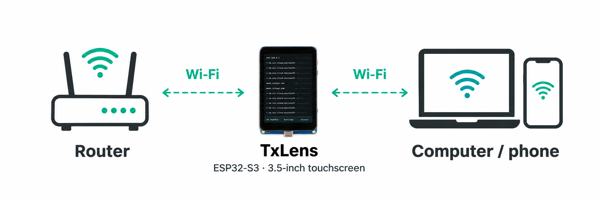
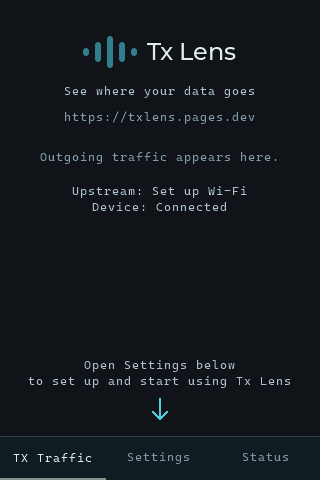
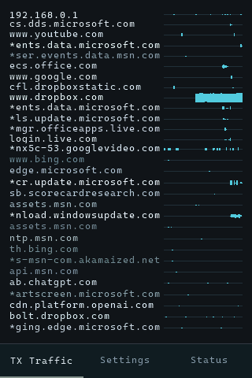
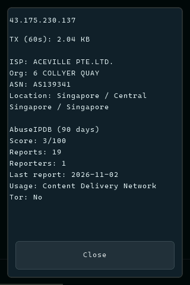
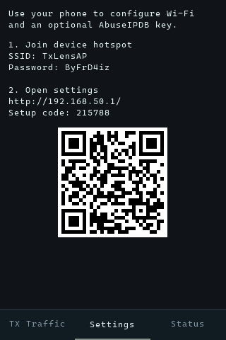
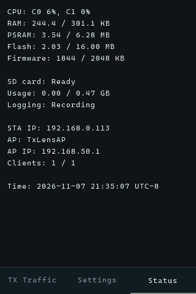

# TxLens

**See where your data goes.**

One of the hardest parts of an advanced persistent threat (APT) is realizing that your computer has been compromised in the first place. An attacker may quietly maintain access and send data out while everything appears normal.

TxLens is a simple, low-cost tool that makes outgoing network activity visible. It runs on an ESP32-S3 with a touchscreen, acting as a small Wi-Fi router between your computer or phone and your existing network. It shows where the connected device sends data and how much it sends, giving you a view of that traffic outside the device itself. A rootkit can hide network activity from monitoring software running on the compromised device. By observing traffic on separate hardware, TxLens provides a more reliable view of the traffic that passes through it.

## A look at the interface

The touchscreen keeps the focus on outgoing traffic, with destination details and device settings close at hand.

| Start screen | Live traffic |
| :---: | :---: |
|  |  |

**TX Traffic** shows destination IP addresses or domain names, when available, alongside live graphs covering the last 60 seconds. It makes bursts of outgoing activity easy to spot.

| Destination details | Settings |
| :---: | :---: |
|  |  |

**Destination details** show recent upload volume, ISP, organization, ASN and location, with optional AbuseIPDB reputation checks. **Settings** provides access to Wi-Fi configuration, while **Status** shows resource usage, network information and logging status. An optional microSD card stores per-minute traffic logs as CSV files.

| Device status | |
| :---: | :---: |
|  | |

## Get started

An **ESP32-S3 with 8 MB of PSRAM and more than 4 MB of flash** is recommended, along with a touchscreen. A **320 × 480** display is a good starting point. Higher resolutions can work, but keeping the display within roughly **480 × 480** is preferable: larger displays increase rendering work and can slow the interface. Upstream Wi-Fi needs to support 2.4 GHz.

1. Clone this repository or download it using GitHub's **Code - Download ZIP**.
2. Open the project in **Visual Studio Code** with the Espressif ESP-IDF extension installed and an ESP-IDF environment configured. This project was developed with **ESP-IDF 6.1**, but newer versions should also work[*].
3. In the ESP-IDF terminal, run `idf.py set-target esp32s3` to select the chip and regenerate any existing build configuration. Adapt the project for your board, then build and flash it using the ESP-IDF extension's controls[*].

[*]: If you run into configuration errors, an AI coding tool can help you troubleshoot and resolve them.

The current firmware includes a specific board's display, touch and pin configuration, and defaults to 16 MB of flash. Other boards need corresponding changes to the hardware settings, drivers and flash configuration. Start with [`main/app_config.h`](main/app_config.h) and `sdkconfig.defaults*`.

## Collaborate

I'm available for cybersecurity projects and consulting. If you have a project in mind, I'd be happy to discuss how I can help.

Contact me at **[tx-lens@outlook.com](mailto:tx-lens@outlook.com)**.
